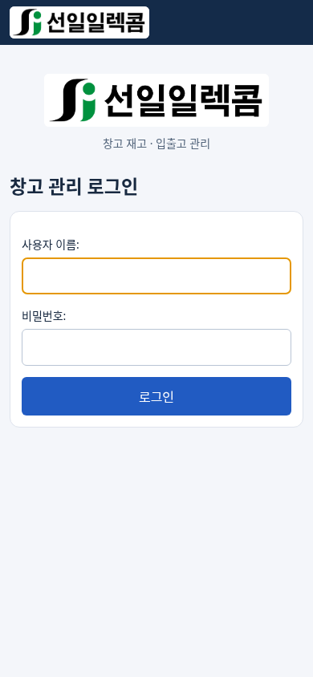
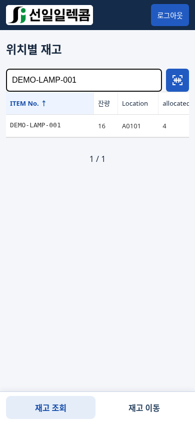
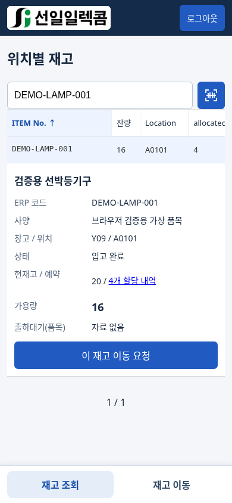
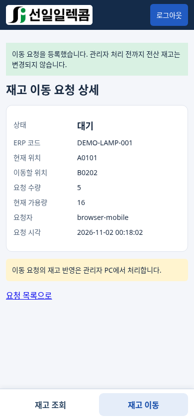
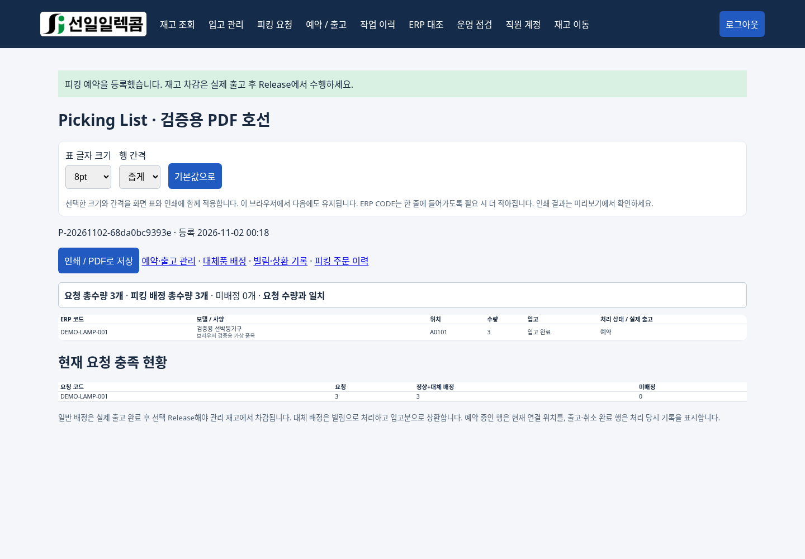
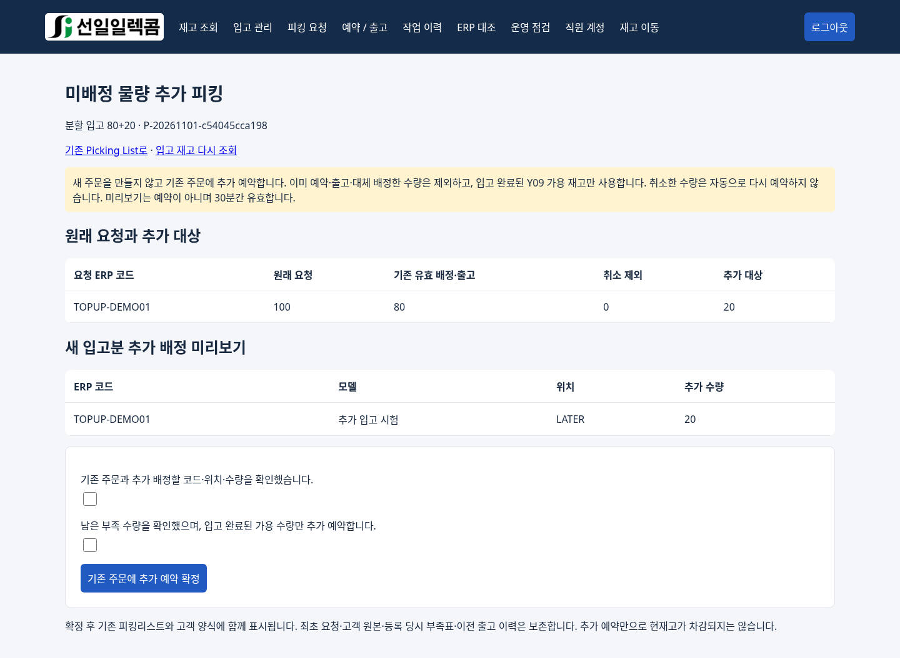
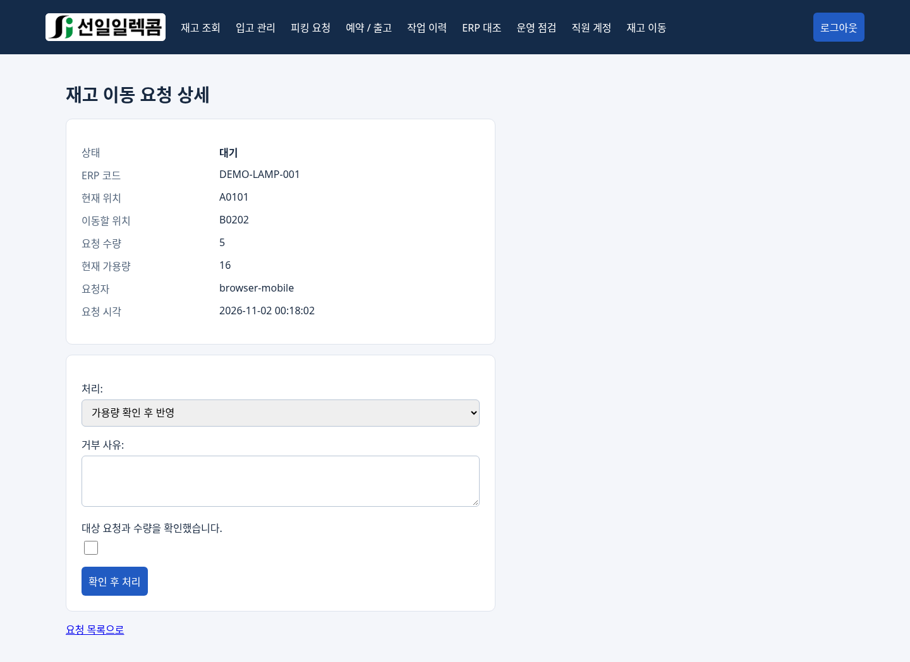

# 선일일렉콤 창고 관리
## 신입사원 사용 매뉴얼

**처음 사용하는 분을 위한 업무 순서·화면 설명·실수 대처 안내**

문서 작성일: 2026년 11월 1일 · 개정: 2026년 11월 2일 · 기능 기준: 두 가지 권한·추가 피킹·사양 표시 적용본

대상: 창고 담당자, 휴대폰 조회 사용자, 입출고 담당 관리자, 업무 인수인계자

이 프로그램은 회사 ERP를 보완하여 부산 창고(Y09)의 위치별 재고와 작업을 관리합니다. 영주(Y02)는 본사 수량을 참고하는 용도입니다. 회사 ERP의 공식 처리 절차는 별도로 따라야 합니다.

이 문서의 화면과 예제는 **가상 데이터**입니다. 실제 회사 자료·비밀번호를 담지 않았습니다. 실제 서버 설치·운영 전환 완료 여부를 보증하는 문서는 아닙니다.

> 먼저 기억하세요: 조회는 수량을 바꾸지 않습니다. 이동 요청도 등록만으로 수량이 바뀌지 않습니다. 입고 확정·Release·이동 반영 등 확정 작업은 전산 수량을 바꿀 수 있습니다.

### 처음 출근했다면

1. 담당자에게 접속 주소와 본인 계정을 받습니다.
2. 일반 직원은 1~5장을 먼저 읽습니다.
3. 입출고 담당자는 6~10장까지 교육을 받습니다.
4. 처음 실습은 운영 재고가 아닌 별도 시험 환경에서 합니다.

### 목차

1. 시작하기: 접속·로그인·권한
2. 수량과 용어 이해하기
3. 휴대폰에서 재고 찾기와 정렬
4. 선택한 재고의 상세와 할당 내역 보기
5. 휴대폰 이동 요청과 결과 확인
6. 관리자 PC: 입고와 도착 확인
7. 관리자 PC: 피킹과 예약
8. 관리자 PC: 실제 출고와 예약 취소
9. 관리자 PC: 이동 승인·거부
10. 담당자 교육 후 사용: 대체 출고와 상환
11. ERP 대조·작업 이력·엑셀 출력
12. 자주 묻는 질문과 오류 대처
13. 하루 업무 점검표와 인수인계
14. 신입사원 실습·확인 문제

---

## 1. 시작하기: 접속·로그인·권한

### 1-1. 접속 전 준비

담당자에게 ‘업무 접속 주소’, ‘본인 사용자 이름’, ‘초기 비밀번호’, ‘문의 담당자’를 받으세요. 비밀번호는 이 매뉴얼이나 공용 메모에 적지 않습니다.

현재 알려진 시험 접속 예시는 `http://192.168.0.100:8000/`입니다. 회사에서 주소를 바꿀 수 있으므로 실제 주소는 담당자가 안내한 것을 사용하세요. 이 주소는 서버가 켜져 있고 허용된 회사 네트워크에 연결돼 있어야 사용할 수 있습니다. 외부에서의 접속을 보장하지 않습니다.

휴대폰에서는 회사가 허용한 Wi-Fi에 연결합니다. 접속이 안 되면 주소 오타·Wi-Fi 연결·서버 가동 여부를 확인합니다. 임의로 공유기나 서버 설정을 변경하지 마세요.

### 1-2. 로그인 순서

1. 브라우저 주소창에 업무 주소를 입력합니다.
2. 선일일렉콤 로고와 ‘창고 관리 로그인’을 확인합니다.
3. 본인 사용자 이름과 비밀번호를 입력합니다.
4. ‘로그인’을 누릅니다.
5. 업무를 마치거나 공용 기기를 떠날 때는 ‘로그아웃’을 누릅니다.

### 1-3. 사용할 수 있는 업무

관리자는 PC 상단 ‘직원 계정’에서 사용자 이름·초기 비밀번호를 입력하고 ‘모든 권한’ 또는 ‘조회 권한’만 선택해 저장합니다. 새 계정은 조회 전용이 기본값입니다. 퇴사자는 활성 체크를 해제해 접속을 막고 기록은 보존합니다. 기존 일반 계정으로 이동 요청을 하던 직원도 이제 모든 권한이 필요합니다. 현재 로그인한 본인 계정의 권한을 낮추거나 비활성화할 수는 없습니다.

| 구분 | 주로 할 수 있는 일 | 주의할 점 |
|---|---|---|
| 조회 권한 | 재고·주문·이동·ERP 대조·이력 조회와 검색·정렬 | 이동 요청을 포함한 모든 등록·수정·처리가 불가합니다. |
| 모든 권한 | 업무 조회, 품목·입고·피킹·출고·이동·ERP 대조와 직원 계정 관리 | 확정 전에 코드·위치·수량을 확인합니다. |
| 휴대폰 화면 | 재고 조회, 할당 확인, 이동 요청·결과 확인 | 관리자 계정이어도 화면은 간소화됩니다. 관리 업무는 PC에서 합니다. |

계정 권한과 화면 크기는 다릅니다. 조회 전용도 PC에서 전체 업무 화면을 읽을 수 있지만 등록·수정·처리는 할 수 없습니다. 휴대폰에서 특정 버튼이 안 보인다고 오류로 판단하지 마세요.

---

## 2. 수량과 용어 이해하기

### 2-1. 표의 각 열

| 표시 | 쉬운 설명 | 예 |
|---|---|---|
| ITEM No. / ERP 코드 | 제품을 구분하는 품번 | `ACS12CW1SW00` |
| 잔량 / 가용량 | 현재고에서 이미 예약한 수량을 뺀 수량 | 현재고 10 − allocated 3 = 잔량 7 |
| Location | 물건이 놓인 위치 또는 예정 재고 식별자 | `C0301`, `FLOOR` |
| allocated | 특정 호선·프로젝트에 이미 예약한 수량 | 다른 업무에서 자유롭게 사용하면 안 되는 수량 |
| HULL | 해당 위치의 현재 예약 호선·프로젝트와 수량 | `호선4281 (3)` |
| 현재고 | 프로그램에 등록된 수량. 예정 물량을 포함할 수 있음 | 실물 도착 여부는 상태를 함께 확인 |
| 입고 예정 / 입고 완료 | 아직 도착하지 않은 물량 / 도착한 물량 | 예정분은 실제 이동·출고 전에 도착 확인 필요 |
| Release | 실제 출고 완료 사실을 전산에 확정하는 처리 | ‘예약’과 다릅니다. |
| SEQ / 주문 번호 | 예약이나 주문을 다시 찾기 위한 식별 정보 | 담당자 문의 시 함께 전달 |

ERP 코드는 현장 기준 12자리이며 `-`, `*` 같은 문자가 들어갈 수 있습니다. 숫자로 바꾸거나 특수기호를 지우지 말고 원문 그대로 확인하세요. 프로그램은 화면에서 한 줄로 보여줍니다.

### 2-2. 예약과 출고는 다릅니다

현재고 10개, allocated 0개인 제품을 3개 예약하면 현재고는 10개, allocated는 3개, 잔량은 7개입니다. 그 3개를 실제 출고하고 Release하면 현재고는 7개, allocated는 0개, 잔량은 7개가 됩니다.

> ‘예약이 잡혔다’는 말은 ‘실물이 이미 나갔다’는 뜻이 아닙니다. 반대로 실제 출고했더라도 전산 확정을 놓치면 예약이 남을 수 있습니다.

### 2-3. 반드시 구분할 수량

회사 ERP의 ‘출하대기’는 이 프로그램의 allocated와 다른 값입니다. 같은 출하대기 수량이 여러 위치에 보이더라도 위치별 수량으로 더하거나 현재고에서 다시 빼지 않습니다. 회사 ERP 대조 자료가 없으면 ‘자료 없음’으로 표시될 수 있으며, 이는 0개라는 뜻이 아닙니다.

예정 물량도 예약될 수 있습니다. 잔량이 있어도 실물 재고가 있다고 단정하지 말고 상세의 입고 상태와 실제 창고를 확인하세요.

---

## 3. 휴대폰에서 재고 찾기와 정렬

PC 표는 ITEM No.와 사양을 별도 열로 표시합니다. 위치별 사양이 없으면 품목 기본 사양을 사용하며 사양은 줄바꿈·말줄임 없이 한 줄로 보여줍니다. 긴 내용은 표 안을 가로로 밀어 확인합니다. PC 표는 창고 열을 숨기고 상태는 완료/예정, 이동 링크는 이동, 출하대기 제목은 출하대기로 표시합니다. 수량과 처리 절차의 의미는 같습니다. 휴대폰은 행을 펼쳐 사양을 확인합니다.

### 3-1. 재고 찾기

1. 하단의 ‘재고 조회’를 누릅니다.
2. 검색창에 ERP 코드·모델·사양·위치 중 알고 있는 값을 입력합니다.
3. 입력이 약 0.3초 멈추면 결과가 자동 갱신됩니다. 다른 영역을 누르거나 키보드를 닫을 필요가 없습니다.
4. 전체 목록으로 돌아가려면 검색어를 모두 지웁니다.
5. 결과가 많으면 아래의 ‘다음’으로 이동합니다. 한 페이지에 최대 50개 항목이 표시됩니다.

검색은 입력한 글자가 들어 있는 항목을 찾는 방식입니다. 일부 코드만 입력하면 여러 품목이 함께 나올 수 있습니다. 실제 작업 전에는 전체 ERP 코드와 위치를 다시 확인하세요.

검색창 오른쪽 스캔 아이콘은 바코드·QR 라벨을 읽는 기능입니다. 아이콘을 눌러 카메라 또는 사진을 선택하면 인식한 텍스트로 자동 검색합니다. 아이콘을 누르기 전에는 카메라가 켜지지 않습니다.

### 3-2. 헤더를 눌러 정렬하기

표 맨 위의 ITEM No. / 잔량 / Location / allocated / HULL을 누르면 정렬됩니다. 같은 헤더를 다시 누르면 반대 방향으로 바뀝니다. 화살표 ↑는 오름차순, ↓는 내림차순입니다.

| 원하는 일 | 누를 헤더 | 확인할 방향 |
|---|---|---|
| 품번순으로 보기 | ITEM No. | ↑ |
| 가용 수량이 많은 제품부터 보기 | 잔량 | ↓ |
| 위치순으로 보기 | Location | ↑ |
| 예약 수량이 많은 위치부터 보기 | allocated | ↓ |
| 예약 호선명순으로 보기 | HULL | ↑ |

정렬은 지금 보이는 50개만이 아니라 검색된 전체 항목에 적용합니다. 검색어를 바꾸거나 다음 페이지로 이동해도 선택한 정렬은 유지됩니다. 잔량과 allocated는 숫자로 정렬합니다. HULL에 여러 호선이 있으면 이름순으로 첫 번째 호선명을 기준으로 정렬합니다. HULL을 누른다고 그 호선만 필터링되는 것은 아닙니다.

좁은 휴대폰에서는 표 안을 좌우로 밀어 오른쪽 열을 확인합니다. 정렬용 헤더를 누르는 것과 재고 행을 누르는 것은 다릅니다.

---

## 4. 선택한 재고의 상세와 할당 내역 보기

### 4-1. 상세 열기

1. 재고 표에서 확인할 행을 누릅니다.
2. ERP 코드·모델·사양·창고·위치·입고 상태를 확인합니다.
3. 현재고·예약·가용량과 예정일을 함께 봅니다.
4. 확인이 끝나면 같은 행을 눌러 접습니다.

같은 ERP 코드가 여러 행에 나오는 것은 위치 또는 입고 상태가 다르기 때문일 수 있습니다. 이동 요청할 때는 원하는 출발 위치의 행을 선택하세요.

### 4-2. 이미 예약된 수량의 주인 확인

1. 상세에서 ‘N개 할당 내역’을 누릅니다.
2. 호선·프로젝트, 할당 수량, SEQ 또는 주문 번호를 확인합니다.
3. 현재 위치에 예약된 내역만 보이는지 확인합니다.
4. 다른 호선의 물량이 필요하면 담당자와 먼저 협의합니다.

할당 합계와 원장 allocated가 다르다는 안내가 나오면 임의로 수량을 수정하지 말고 담당자에게 알려주세요. 완료 출고·취소·이미 출고한 대체품은 현재 allocated 내역에서 제외됩니다.

### 4-3. 실수 방지

- 품번이 비슷해도 전체 코드와 사양을 대조합니다.
- 같은 품번이라도 위치가 다르면 별도 재고입니다.
- 잔량 0개는 프로그램상 자유롭게 쓸 물량이 없다는 뜻입니다.
- 조회·정렬·상세 열기는 재고를 바꾸지 않습니다.

---

## 5. 휴대폰 이동 요청과 결과 확인

이동 요청은 **모든 권한** 계정만 할 수 있습니다. 조회 권한은 전체 직원의 요청과 결과를 읽을 수 있지만 새 요청·승인·거부는 할 수 없습니다.

### 5-1. 이동 요청 등록

예: C0301의 제품 10개 중 예약 3개를 제외한 잔량 7개에서 2개를 D0101로 옮기려는 상황입니다.

1. 재고 조회에서 ERP 코드와 출발 위치 C0301을 찾습니다.
2. 행을 펼치고 입고 완료 여부와 가용량을 확인합니다.
3. ‘이 재고 이동 요청’을 누릅니다.
4. ‘이동할 위치’에 D0101, ‘요청 수량’에 2를 입력합니다.
5. 품목·출발 위치·도착 위치·수량을 다시 확인하고 확인란에 체크합니다.
6. ‘이동 요청 등록’을 누릅니다.
7. 요청 상세가 열리면 ‘대기’ 상태와 입력 내용을 확인합니다.

> 이동 요청만으로 전산 재고는 바뀌지 않습니다. 실제 물건을 언제 옮길지는 현장의 정해진 절차와 관리자 지시에 따르세요. 임의로 먼저 옮기거나, 승인됐다고 물리적으로 이동까지 끝났다고 생각하면 안 됩니다.

### 5-2. 처리 결과 확인

하단 ‘재고 이동’을 누릅니다. 두 권한 모두 전체 직원의 이동 내역을 조회합니다. 이 화면은 처음에 대기 요청을 보여주므로 완료 건을 찾을 때는 상태를 ‘완료’ 또는 ‘전체 상태’로 바꿉니다. 품번·출발 위치·도착 위치로 검색하며 입력 후 자동 갱신됩니다.

| 상태 | 뜻 | 다음 행동 |
|---|---|---|
| 대기 | 아직 관리자가 전산 반영하지 않음 | 입력 내용을 확인하고 관리자 처리 대기 |
| 완료 | 관리자가 전산 이동을 반영함 | 출발/도착 위치 수량과 실물 위치 확인 |
| 거부 | 전산 이동을 반영하지 않음 | 사유를 읽고 담당자에게 문의 |

이동 버튼이 없으면 입고 예정이거나 가용량이 0일 수 있습니다. 요청 후 다른 예약이 생기면 관리자의 처리 시점에 가용량이 부족해질 수 있습니다.

잘못 요청했다면 같은 요청을 여러 번 만들지 말고 관리자에게 거부 처리를 요청합니다. 이미 완료된 이동의 정정은 담당자가 실물을 확인한 뒤 별도 거래로 처리합니다.

---

## 6. 관리자 PC: 입고와 도착 확인

이 장은 입고 권한을 부여받고 담당자 교육을 마친 사람만 사용합니다.

### 6-1. 새 물량 입고

1. PC의 ‘입고 관리’에서 ‘새 입고 등록’을 엽니다.
2. 품목을 선택하고 수량을 입력합니다.
3. 실제 도착한 물건은 ‘입고 완료’, 아직 도착하지 않은 물건은 ‘입고 예정’을 선택합니다.
4. 실제 위치 또는 예정 재고 식별자를 입력합니다.
5. 예정 재고라면 예정일과 발송 담당자를 입력합니다.
6. 입력 내용과 실물을 확인한 뒤 화면의 등록 버튼으로 확정합니다.
7. 재고 조회와 입고 원거래 목록에서 코드·위치·수량을 확인합니다.

제품이 선택 목록에 없으면 담당 관리자에게 품목 등록을 요청합니다. 비슷한 코드의 다른 품목으로 임시 등록하지 마세요.

### 6-2. 이미 예정 등록한 물량이 도착했을 때

새 입고로 다시 등록하면 중복 재고가 될 수 있습니다. PC 재고 목록에서 해당 예정 행의 ‘도착 확인’을 누르고 실제 입고 위치를 지정합니다. 예정 수량과 예약 연결이 함께 도착 위치로 전환됩니다.

현재 도착 확인은 해당 예정 행의 전량 처리입니다. 일부만 도착했다면 임의로 전량 도착 처리하지 말고 담당자와 별도 예정 건 분리 등 처리 방식을 먼저 정합니다.

### 6-3. 엑셀 일괄 입고

‘입고 관리 → 엑셀 일괄 입고’에서 품목코드·품목명·사양·수량·Location의 A~E열을 붙여넣거나 Excel 파일을 선택합니다. 최대 1,000행의 미리보기를 검토한 뒤 확정합니다.

일괄 입고는 모두 입고 완료로 처리합니다. 기존 예정분의 도착 확인 대신 사용하지 않습니다. 한 행이라도 잘못되면 전체 반영이 차단될 수 있으므로 오류 위치를 고쳐 다시 확인합니다. 같은 파일을 새 입고로 반복 제출하면 중복 업무가 될 수 있으므로 원거래 목록을 먼저 확인하세요.

### 6-4. 잘못 입력한 입고

‘입고 원거래’에서 해당 건의 ‘원거래 취소’를 선택하고 사유를 남깁니다. 원거래 전량 취소이며 일부만 취소하는 기능이 아닙니다. 이미 이동·예약·출고·도착 전환·상환에 사용한 기록은 조건에 따라 취소가 차단됩니다. DB에서 삭제하거나 임의 수량 보정으로 해결하지 마세요.

---

## 7. 관리자 PC: 피킹과 예약

피킹은 출고할 물건을 찾고 모으는 작업입니다. 이 프로그램에서 피킹 등록은 먼저 ‘예약’을 만드는 절차입니다.

### 7-1. 기본 입력

1. PC에서 ‘피킹 요청’을 엽니다.
2. 프로젝트 / 호선을 입력합니다.
3. Excel에서 **수량 → ERP 코드** 두 열을 복사해 붙여넣습니다.
4. 제목 행은 제외하고, 최대 500행으로 준비합니다.
5. 미리보기에서 요청 수량·배정 위치·예정분 포함 여부·부족 수량을 확인합니다.
6. 내용을 확인하고 예약을 확정합니다. 부족분이 있으면 확보 가능한 물량만 예약한다는 확인이 필요합니다.

| 수량 | ERP 코드 |
|---|---|
| 4 | ACS12CW1SW00 |
| 2 | AB12-CD*0001 |

위 표는 설명용입니다. 실제로 붙여넣을 때는 제목 없이 값 두 열만 사용합니다. 코드가 숫자로 보이더라도 앞자리 0과 특수기호를 보존합니다.

### 7-2. 미리보기와 예약 확정 구분

미리보기만 연 상태는 예약이 아닙니다. 미리보기는 30분 후 만료되며 그 사이 재고가 바뀌면 다시 계산해야 할 수 있습니다. 중복 품번은 합산됩니다. 위치 배정은 현재 원장 순서이며, 선입선출이나 최단 동선을 자동 보장하지 않습니다.

부족표의 Y02는 본사 ERP 참고 수량입니다. 부산에서 바로 쓸 수 있거나 자동으로 예약됐다는 뜻이 아닙니다.

### 7-3. 고객 양식과 인쇄

고객 자료가 있으면 두 열 대신 ‘POR번호·호선·블록·품명·수량·ERP CODE’ 6열을 붙여넣거나 Excel로 입력합니다. 두 방식은 동시에 사용하지 않습니다.

예약 후 기본 피킹리스트 또는 ‘고객 양식 인쇄’를 선택합니다. 인쇄 전 요청 총수량·배정 총수량·미배정 수량과 코드별 수량을 확인합니다. 배정 합계는 실제 출고 완료량과 다를 수 있습니다.

인쇄 기본값은 8pt·좁게이며 브라우저 배율은 100%를 기준으로 합니다. 글자 크기를 바꾸면 인쇄 미리보기에서 코드·수량·위치가 잘리지 않는지 확인하세요.

### 7-4. 나중에 들어온 부족분을 같은 주문에 추가하기

예: 주문 100개 중 80개를 먼저 배정·출고했고, 나중에 20개가 입고된 경우입니다.

1. 추가 물량을 입고 완료로 등록합니다. 기존 예정분이라면 도착 확인합니다.
2. 피킹 주문 이력에서 기존 주문을 엽니다. 찾기 어려우면 주문 상태를 ‘전체’로 바꿉니다.
3. ‘미배정 물량 추가 피킹’을 누릅니다.
4. 원래 요청·기존 배정/출고·취소 제외 수량과 새 입고 위치를 확인합니다.
5. 확인란에 체크하고 ‘기존 주문에 추가 예약 확정’을 누릅니다. 일부만 확보되면 부분 추가 배정 확인도 필요합니다.
6. 같은 주문 번호의 피킹리스트·고객 양식을 다시 확인하거나 인쇄합니다. 실제 출고 후 추가 행을 Release합니다.

새 주문은 생기지 않으며 1차 출고 이력과 최초 부족표를 보존합니다. 8개만 들어오면 먼저 추가하고 이후 남은 12개를 같은 방법으로 추가할 수 있습니다. 예정 물량, 이미 배정/출고한 수량, 취소 수량을 중복 예약하지 않습니다. 모든 배정이 취소된 주문과 원래 요청 자료가 없는 이전 주문은 추가하지 않습니다. 모든 권한 계정만 사용할 수 있습니다.

---

## 8. 관리자 PC: 실제 출고와 예약 취소

### 8-1. 출고 전 확인

실물 품번·수량·위치·호선이 피킹리스트와 같은지 확인합니다. 예정 재고라면 먼저 실제 도착을 확인해야 합니다. 출고하지 않은 물량을 Release하지 않습니다.

### 8-2. Release 순서

1. PC의 ‘예약 / 출고’를 엽니다.
2. 프로젝트·호선 및 SEQ / 주문 ID로 대상 범위를 좁힙니다.
3. 실제 출고한 행만 체크합니다.
4. 처리에서 ‘실제 출고 완료 → Release’를 선택합니다.
5. 실제 출고 시각을 한국 시간으로 입력합니다.
6. 처리 범위와 각 행 수량을 확인하고 확인란에 체크합니다.
7. ‘선택 범위 전량 처리’를 누릅니다.
8. 재고와 주문 이력에서 결과를 확인합니다.

각 행은 전량 처리합니다. 10개 예약한 한 행 중 3개만 출고했는데 그 행 전체를 선택하면 안 됩니다. 부분 출고가 필요한 경우 확정 전에 담당자와 예약 분리 등 처리 방법을 협의하세요.

### 8-3. 선택 범위 주의

| 선택 방법 | 대상 |
|---|---|
| 체크한 행만 처리 | 지금 선택한 행 |
| 현재 페이지 전체 선택 | 현재 페이지에 보이는 행 |
| 필터 결과 전체 N행 처리 | 다른 페이지까지 포함한 필터 결과 전체 |

Shift+클릭으로 현재 페이지의 범위를 선택할 수 있습니다. 페이지를 이동하면 개별 체크 선택은 유지되지 않습니다. ‘필터 결과 전체’는 실제로 그 전체 물량을 출고했을 때만 사용합니다. 대상이 바뀌었다는 오류가 나오면 새로 조회해 확인합니다.

### 8-4. 예약이 필요 없어졌다면

처리에서 ‘예약 취소’를 선택합니다. 아직 출고하지 않은 일반 예약을 해제하는 작업입니다. 취소하면 allocated가 줄고 그만큼 가용량이 늘며, 현재고는 줄지 않습니다. 이미 출고한 물건의 반품은 예약 취소로 처리하지 않습니다.

대체 배정은 일반 Release 대상이 아닙니다. 빌림·상환 기록에서 따로 처리합니다.

---

## 9. 관리자 PC: 이동 승인·거부

### 9-1. 반영 순서

1. PC에서 ‘재고 이동’을 열고 대기 건을 확인합니다.
2. 요청을 열어 요청자·코드·출발 위치·도착 위치·수량을 확인합니다.
3. 실물 이동 여부 또는 이동 계획을 현장 담당자와 확인합니다.
4. 처리에서 ‘가용량 확인 후 반영’을 선택합니다.
5. 대상 요청과 수량 확인란에 체크하고 ‘확인 후 처리’를 누릅니다.
6. 상태 ‘완료’를 확인하고 출발·도착 위치의 수량을 대조합니다.

처리 시점의 가용량을 다시 검사합니다. 예약 수량과 예정분은 이동할 수 없습니다. 전산 이동이 완료되면 요청 수량만큼 출발 위치가 줄고 도착 위치가 늘어납니다. 전체 물량이 새로 입고되는 것이 아닙니다.

### 9-2. 거부해야 할 때

코드·위치·수량 오류 또는 중복 요청 등으로 진행할 수 없으면 ‘관리자 거부’를 선택합니다. 거부 사유를 입력하고 확인 후 처리합니다. 요청자가 이해할 수 있도록 ‘출발 위치 오류, 올바른 위치 확인 후 재요청’처럼 구체적으로 적습니다.

등록 버튼을 여러 번 누르거나 거부 사유를 빈칸으로 두지 않습니다. 완료 기록은 삭제하지 말고, 정정이 필요하면 현장 확인 후 담당자의 지시에 따릅니다.

---

## 10. 담당자 교육 후 사용: 대체 출고와 상환

이 기능은 코드가 다른 제품을 빌려 출고하고, 나중에 생산 입고분으로 빌린 제품의 재고를 보충하는 절차입니다. 단순 품번 변경이나 반품 기능이 아닙니다. 동일 제품 또는 필요한 수정 가능 여부를 업무 담당자가 확인해야 합니다.

### 10-1. 처리 흐름

1. 고객 요청 코드로 피킹 주문을 만들고 부족분을 확인합니다.
2. 주문 상세의 ‘대체품 배정’에서 요청 코드·빌릴 제품/위치·수량·사유를 입력합니다.
3. 동일 제품 또는 수정 완료와 실제 출고를 확인한 뒤 ‘대체 출고(빌림)’를 처리합니다.
4. 이후 생산품은 요청 코드로 실제 입고합니다. 이미 예정 등록한 물량이라면 도착 확인합니다.
5. 빌림 상세에서 유효한 입고 건·상환 수량·제품 수정 근거를 확인하고 ‘입고분으로 상환’합니다.
6. 전량 상환 후 회사 ERP 코드·수량을 확인하고 ‘회사 ERP 정산 확인’을 남깁니다.

### 10-2. 쉬운 예

고객이 A 제품 10개를 요청했습니다. A 5개만 있어 정상 출고하고, B 5개를 빌려 출고했습니다. 나중에 A 5개가 실제 입고되면 이를 상환 처리해 A 재고는 5개 줄이고 B 재고는 5개 늘립니다. 보충되는 위치는 새 생산품의 실제 입고 위치입니다. 상환으로 창고 전체 실물 수량이 늘어나는 것은 아닙니다.

### 10-3. 확정 전 주의

- 대체는 1:1 수량 기준이며 코드가 비슷하다고 자동 선택하지 않습니다.
- 상환은 3개+2개처럼 나눠 처리할 수 있습니다.
- 출고 전 대체 예약은 취소할 수 있지만 이미 나간 대체품은 일반 예약 취소로 되돌리지 않습니다.
- 잘못 확정한 상환을 되돌리는 별도 역거래 기능은 현재 없습니다. 오류 발생 시 추가 확정을 멈추고 담당자에게 전달합니다.
- 회사 ERP 정산 확인은 메모·확인 이력이며 재고를 추가로 바꾸지 않습니다.

---

## 11. ERP 대조·작업 이력·엑셀 출력

### 11-1. 회사 ERP와 비교하기

1. 관리자 PC의 ‘ERP 대조’를 엽니다.
2. 자료 등록에서 형식과 자료 이름, 회사 ERP 자료 기준 시각을 입력합니다.
3. 직접 추출 자료라면 Y09 부산 파일과 Y02 영주 파일을 올바른 칸에 선택합니다.
4. ‘자료 미리보기’로 행 수·수량·음수 확인 대상을 검토합니다.
5. 확인 후 ‘이 자료로 대조 등록’을 누릅니다.
6. 차이 항목에 원인과 조치를 기록합니다.

한 창고 파일만 등록하면 해당 창고 자료만 갱신되고 다른 창고는 이전 최신 참고 자료가 유지될 수 있습니다. 기준 시각을 꼭 확인하세요. 자료 등록은 위치별 재고를 회사 ERP 값으로 자동 덮어쓰는 작업이 아닙니다.

과거 기준 시각을 입력해도 과거의 관리 재고를 자동 복원하지 않습니다. 관리 재고는 대조를 등록한 시점의 값을 보관합니다. 원인 기록의 ‘조치 완료’는 과거 수량 차이를 지우는 버튼이 아닙니다. 필요한 실제 거래/ERP 처리를 마친 뒤 새 자료로 다시 대조합니다.

### 11-2. 어떤 이력을 봐야 하나요?

| 보고 싶은 것 | 확인할 곳 |
|---|---|
| 새 프로그램에서 한 입고·예약·출고·이동 등 | 작업 이력 |
| 주문별 피킹·완료 내역 | 피킹 주문 이력 |
| SEQ 포함 행별 예약·출고·취소 | 전체 행별 거래 |
| 예전 Excel·SEARCH_PHONE 이동 기록 | 기존 Excel 이력 보관 |

기존 Excel 이력은 읽기 전용 보관 자료입니다. 가져온 과거 기록을 다시 실행해 현재 재고에 더하거나 빼지 않습니다.

### 11-3. 엑셀 출력

PC 재고 조회의 엑셀 내보내기는 현재 검색 조건의 전체 항목을 대상으로 하며 최대 50,000행까지 출력합니다. 화면 한 페이지만 출력하는 기능이 아닙니다. 엑셀 행 순서가 모바일에서 선택한 정렬과 같다고 가정하지 말고 파일에서 확인하세요. 내보낸 파일은 조회용이며 DB 백업을 대신하지 않습니다.

운영 점검에서 DB 구조나 allocated 불일치가 나오면 임의 보정하지 않고 최근 거래·원본 자료와 함께 담당자에게 전달합니다.

---

## 12. 자주 묻는 질문과 오류 대처

| 상황 | 먼저 확인할 것 / 대처 |
|---|---|
| 사이트가 열리지 않음 | 업무 주소, 회사 Wi-Fi, 서버 가동 여부를 담당자에게 확인 |
| 로그인 실패 | 대소문자·키보드 언어 확인. 계속 실패하면 반복하지 말고 담당자 문의 |
| 재고가 검색되지 않음 | 검색어를 지우거나 일부 코드로 조회. 모델·위치와 전체 ERP 코드 재확인 |
| 한 품번이 여러 줄로 보임 | 위치·입고 상태가 다른지 확인. 실제 작업할 위치의 행 선택 |
| 입력 후 결과가 안 바뀜 | 최신 프로그램 적용 여부와 네트워크 확인. 화면 새로고침 후 재확인 |
| 다음 페이지에서 정렬이 달라 보임 | 헤더 화살표·검색어 확인. HULL은 첫 호선명 기준임을 확인 |
| 이동 버튼이 안 보임 | 예정분인지, 가용량이 0인지 상세에서 확인 |
| 이동 요청이 목록에서 사라짐 | 기본 상태가 대기일 수 있음. 완료/거부/전체 상태로 변경 |
| 승인하려는데 가용량 부족 | 다른 예약·거래로 수량이 바뀌었는지 확인. 강제로 반영하지 않음 |
| 수량 합계가 맞지 않음 | 위치·상태·예약·미처리 이동·예정분을 구분해 관리자 확인 |
| 휴대폰에 입고·승인 메뉴가 없음 | 정상적인 간소화 화면. 관리 업무는 권한 있는 계정으로 PC에서 처리 |
| 사진과 메뉴가 다름 | 기기 폭·권한·서버 버전 차이 확인 |

### 12-1. 카메라·바코드 관련

휴대폰 검색창 오른쪽의 작은 바코드·QR 스캔 아이콘을 누르면 인식 창이 열립니다. HTTPS와 카메라 권한이 준비된 환경에서는 실시간 카메라를 사용하고, HTTP 접속이나 권한 제한 시에는 창 안의 사진 촬영 / 이미지에서 읽기를 이용합니다. 인식한 코드는 검색창에 입력되고 바로 조회됩니다. 카메라로 수량을 변경하지는 않습니다. PC에서는 카메라 버튼과 안내문을 표시하지 않습니다. 검색창 직접 입력과 키보드형 외부 스캐너는 계속 사용할 수 있습니다.

실시간 카메라는 브라우저가 신뢰하는 HTTPS 주소와 카메라 권한이 필요합니다. `http://192.168...` 내부 주소에서는 차단될 수 있습니다. 주소의 http를 https로 바꾸는 것만으로 해결되지 않습니다. 사진 인식은 선명도·크기·라벨 형식에 따라 실패할 수 있습니다.

### 12-2. 잘못 눌렀을 때

조회·정렬은 다시 검색하면 됩니다. 확정 거래라면 연속해서 같은 작업을 새로 만들지 말고 처리 결과와 이력을 확인합니다. 입고 취소·예약 취소·이동 거부는 서로 다른 기능입니다. 이미 출고·완료된 거래를 숨기려고 기록을 삭제하거나 DB를 직접 수정하지 않습니다.

### 12-3. 문의할 때 전달할 정보

‘언제 / 어떤 사용자 / 어느 화면 / ERP 코드 / 출발·도착 위치 / 수량 / 주문·요청 번호 / 기대 결과 / 실제 결과’를 적습니다. 오류 문구와 화면을 함께 남기되 비밀번호는 보내지 않습니다. 통신이 끊긴 확정 거래는 먼저 반영 여부를 확인한 뒤 담당자 지시를 따릅니다.

---

## 13. 하루 업무 점검표와 인수인계

### 출근 후

- [ ] 본인 계정으로 접속하고 오늘 처리할 호선·작업을 확인했습니다.
- [ ] 도착 예정품과 대기 이동 요청을 담당자와 확인했습니다.
- [ ] 재고가 운영 자료인지 시험 자료인지 확인했습니다.

### 작업할 때마다

- [ ] 전체 ERP 코드·사양·위치를 실물과 비교했습니다.
- [ ] 현재고·allocated·잔량과 입고 상태를 확인했습니다.
- [ ] 예정분을 실물 재고로 오인하지 않았습니다.
- [ ] 확정 버튼을 누르기 전 대상과 전량 수량을 확인했습니다.
- [ ] 확정 후 목록·상세·이력에서 결과를 확인했습니다.

### 퇴근 전

- [ ] 실제 출고했는데 Release하지 않은 건이 없는지 확인했습니다.
- [ ] 이동 대기·거부 건을 담당자에게 전달했습니다.
- [ ] 잘못 입력한 건과 ERP 차이를 숨기지 않고 기록했습니다.
- [ ] 공용 기기에서 로그아웃했습니다.

### 관리자·인수인계 담당자

- [ ] 운영 서버·접속 주소·계정 담당자를 정했습니다.
- [ ] 백업 성공 여부와 별도 저장소 보관 여부를 확인했습니다.
- [ ] 정해진 주기에 시험 복원을 수행할 담당자를 정했습니다.
- [ ] 회사 ERP와 이 프로그램의 기록 역할을 구분했습니다.
- [ ] 실제 재고·활성 예약·미상환·대기 이동을 인계했습니다.
- [ ] 프로그램을 업데이트할 때 `laptop-real-data`와 실제 운영 DB를 보존합니다.

실무용 자료가 들어 있는 DB를 교육 실습이나 설치 확인 목적으로 초기화하지 마세요. 과거 백업으로 복구할 때는 백업 이후 거래가 사라질 수 있으므로 담당자가 보존·복원 절차를 판단해야 합니다.

---

## 14. 신입사원 실습·확인 문제

**아래 실습은 담당자가 준비한 별도 시험 환경에서만 합니다. 실제 운영 재고로 시험하지 않습니다.**

### 14-1. 조회·이동 실습

1. 본인 시험 계정으로 로그인합니다.
2. 지정된 ERP 코드를 검색하고 검색어를 지워 전체 목록으로 돌아갑니다.
3. 잔량 헤더를 두 번 눌러 숫자 정렬 방향이 바뀌는지 확인합니다.
4. 지정된 위치의 행을 펼쳐 코드·상태·현재고·예약·잔량을 읽어 말합니다.
5. 할당 내역에서 호선과 수량을 확인합니다.
6. 모든 권한이 있는 실습자만 담당자가 지정한 시험 이동 요청을 등록합니다. 조회 전용 직원은 등록 버튼이 없고 요청 결과만 읽을 수 있음을 확인합니다.
7. 관리자가 처리한 후 완료 목록에서 결과를 확인하고 로그아웃합니다.

### 14-2. 관리자와 함께하는 실습

시험 입고 → 피킹 예약 → 실제 출고 가정 확인 → Release → 결과 대조의 순서로 진행합니다. 이어서 시험 이동 요청을 반영하거나 거부하고 결과가 사용자 화면에 보이는지 확인합니다. 대체 출고·상환은 별도 교육 후 진행합니다.

### 14-3. 확인 문제

| 문제 | 정답 |
|---|---|
| 현재고 20, allocated 6이면 잔량은? | 14 |
| 이동 요청 등록 직후 재고가 바뀌나요? | 아니요. 관리자 반영이 필요합니다. |
| 예정 등록한 물건이 도착하면 새 입고로 다시 등록하나요? | 아니요. 해당 예정 건의 도착 확인을 사용합니다. |
| 예약했지만 아직 출고하지 않은 물량을 없애려면? | 일반 예약이면 예약 취소. Release가 아닙니다. |
| 10개 예약한 한 행에서 3개만 실제 출고했다면 전량 Release해도 되나요? | 안 됩니다. 담당자와 분리 처리 방식을 먼저 확인합니다. |
| 휴대폰 잔량 내림차순은 어떻게 하나요? | 잔량 헤더를 눌러 ↓가 되게 합니다. |
| ERP 자료 없음은 0개인가요? | 아니요. 참고 자료가 없다는 뜻입니다. |

교육일: ____________________  교육자: ____________________

교육받은 직원: ____________________  확인 서명: ____________________

### 마지막으로 기억할 네 가지

**전체 코드 확인 → 위치 확인 → 수량·상태 확인 → 처리 결과 확인**
